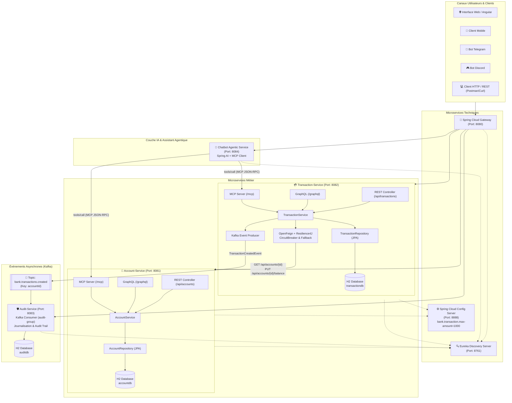
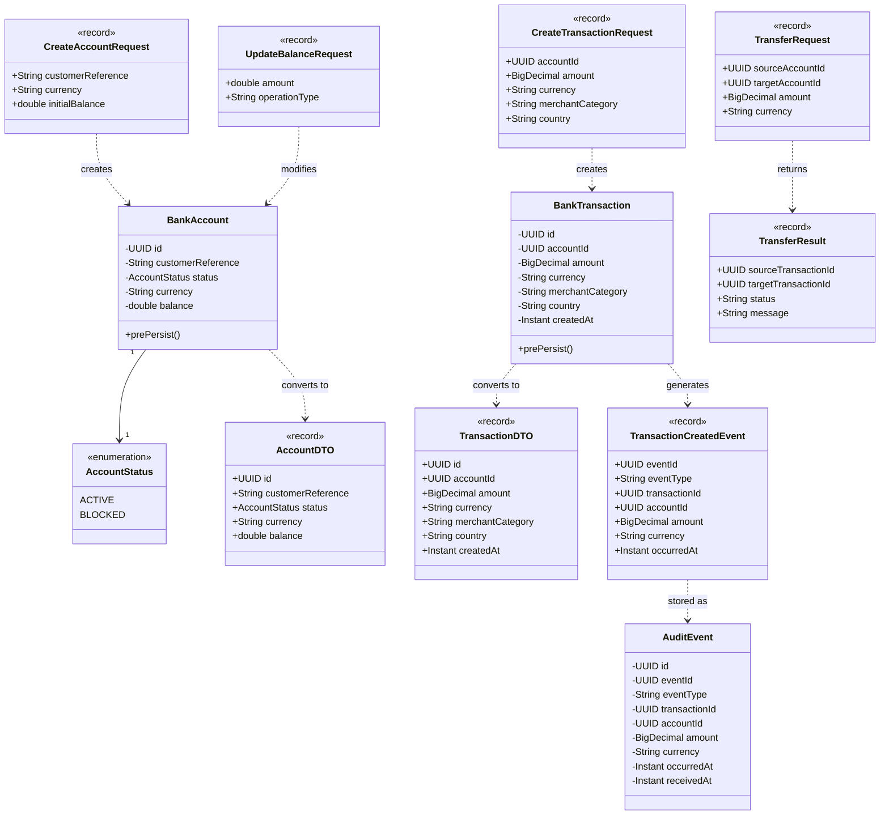

# PLATEFORME BANCAIRE MICROSERVICES - RAPPORT D'ARCHITECTURE ET DE CONCEPTION

> **Épreuve Technique de Sélection — Architecture micro-services, IA et développement full-stack**  
> **Réalisation : Parties A à F**  
> **Auteur : Candidat Adria PFE 2026**

---

## 1. Schéma d'Architecture Cible

L'architecture est découpée en microservices métiers et techniques selon les principes de Spring Cloud, EDA (Event-Driven Architecture) avec Apache Kafka, communication synchrones résilientes (OpenFeign + Resilience4J), connecteurs unifiés (REST, GraphQL, MCP), et agent conversationnel basé sur le Model Context Protocol (MCP) et Spring AI.



---

## 2. Diagramme de Classes Métier

Le diagramme ci-dessous illustre le modèle objet et les contrats de données selon les spécifications :



---

## 3. Séparation Stricte des Couches (Règle d'Architecture)

Pour chaque microservice métier (`account-service` et `transaction-service`), une séparation rigoureuse en 6 couches a été appliquée :

1. **`domain/`** : Entités JPA, DTOs (Records Java 21), requêtes validées avec Bean Validation (`@Valid`), enums et exceptions métier.
2. **`repository/`** : Interfaces Spring Data JPA étendant `JpaRepository`.
3. **`service/`** : Couche d'orchestration et logique métier (`AccountService`, `TransactionService`, `AccountServiceClient` OpenFeign, `TransactionEventProducer`).
4. **`web/rest/`** : Contrôleurs REST (`@RestController`) exposant les endpoints HTTP CRUD standards et gestionnaire d'exceptions global (`@RestControllerAdvice`).
5. **`web/graphql/`** : Contrôleurs Spring GraphQL (`@Controller`, `@QueryMapping`, `@MutationMapping`) s'appuyant sur les schémas `schema.graphqls`.
6. **`mcp/`** : Implémentation du protocole **Model Context Protocol (Anthropic MCP standard)** exposant les définitions de tools (`tools/list`) et leur exécution (`tools/call`) via JSON-RPC 2.0 et endpoints REST.

> **Règle fondamentale respectée** : Les contrôleurs REST, GraphQL et MCP appellent **strictement la même couche service**, garantissant l'intégrité et la centralisation des règles métier bancaires.

---

## 4. Règles Métier et Tolérance aux Pannes

### 4.1. Règles Métier dans `transaction-service`
1. **Montant strictement positif** : Tout montant $\le 0$ lève immédiatement une `TransactionException`.
2. **Plafond configuré** : Injection dynamique du paramètre `bank.transaction.max-amount=1000` depuis le `config-service`. Toute transaction ou virement dépassant ce plafond est rejeté.
3. **Existence et statut actif du compte** : Appel préalable de l'API de `account-service` via OpenFeign. Si le statut est `BLOCKED`, la transaction est refusée.
4. **Concordance des devises** : La devise de la transaction (ex: `EUR`) doit concorder exactement avec la devise du compte.
5. **Vérification et mise à jour du solde** : Le solde disponible est vérifié avant persistance. Après l'enregistrement réussi de la transaction en base, le solde du compte est débité via OpenFeign.
6. **Virement inter-comptes** : Débit du compte émetteur, crédit du compte bénéficiaire, enregistrement de deux transactions miroir et publication des événements Kafka correspondants.

### 4.2. Tolérance aux Pannes avec Resilience4J
- Intégration de **Spring Cloud OpenFeign** et **Resilience4J CircuitBreaker**.
- Décoration de l'interface client `AccountServiceClient` avec un `fallback` dédié (`AccountServiceClientFallback`).
- `@CircuitBreaker(name = "accountService", fallbackMethod = "createTransactionFallback")` sur les méthodes sensibles du service.
- En cas de panne, ralentissement ou indisponibilité de `account-service`, le disjoncteur bascule en mode ouvert et invoque une réponse dégradée sécurisée sans bloquer le thread ni propager d'erreur fatale.

---

## 5. Agent Conversationnel et Protocole MCP (Partie E)

Le microservice `chatbot-service` (Port 8084) réalise l'assistant bancaire agentique :
- Connecté en tant que client MCP aux serveurs MCP de `account-service` et `transaction-service`.
- Découvre dynamiquement les outils bancaires (`get_account_by_id`, `create_bank_account`, `update_account_balance`, `create_transaction`, `transfer_funds`, `list_all_accounts`).
- Analyse en langage naturel la requête utilisateur (NL Intent Resolution).
- Exécute le tool approprié et retourne une réponse claire et sécurisée.
- Exposé via un endpoint REST `POST /api/chat` et adaptable directement pour Telegram et Discord.

---

## 6. Communication Asynchrone avec Apache Kafka (Partie F)

1. **Producteur (dans `transaction-service`)** :
   - Publication asynchrone après persistance dans le topic `bank.transactions.created`.
   - Utilisation explicite de `accountId` comme clé de partitionnement Kafka (`key = accountId.toString()`).
   - Format d'événement conforme à la spécification :
     ```json
     {
       "eventId": "UUID",
       "eventType": "TransactionCreated",
       "transactionId": "UUID",
       "accountId": "UUID",
       "amount": 250.00,
       "currency": "EUR",
       "occurredAt": "2026-01-15T10:30:00Z"
     }
     ```
2. **Consommateur (dans `audit-service`)** :
   - `@KafkaListener` sur le topic avec groupe `audit-group`.
   - Journalisation structurée SLF4J de l'événement.
   - Enregistrement dans la table `audit_events` pour audit trail, **sans aucune modification des données bancaires**.

---

## 7. Guide d'Exécution et Tests

### Compilation et validation du projet complet :
```bash
export JAVA_HOME=/opt/homebrew/opt/openjdk@21
export PATH=$JAVA_HOME/bin:$PATH
mvn clean test
```

### Lancement avec Docker Compose :
```bash
docker-compose up --build
```

