# Plateforme Bancaire Microservices, IA Agentique & EDA

[](https://openjdk.org/)
[](https://spring.io/projects/spring-boot)
[](https://spring.io/projects/spring-cloud)
[](https://angular.dev/)
[](https://kafka.apache.org/)
[](https://graphql.org/)
[](https://modelcontextprotocol.io/)
[](https://www.docker.com/)

> **Épreuve Technique de Sélection — PFE 2026 ADRIA Business & Technology** 
> **Auteur :** Imane Mekkaoui 
> **Dépôt GitHub :** `Mekkaoui-Imane-test-adria-pfe-27` 
> **Périmètre réalisé :** Parties A, B, C, D, E, F, G (Client Web Angular Clair), H (IA Détection de Fraude Python) & I (DevOps)  
> **Rapport d'Architecture :** [`RAPPORT_ARCHITECTURE.md`](RAPPORT_ARCHITECTURE.md) (Rapport PDF déposé sur Classroom)

---

## Sommaire

1. [Contexte Métier & Objectifs](#contexte-métier--objectifs)
2. [Schéma d'Architecture Globale](#schéma-darchitecture-globale)
3. [Client Web Angular (Partie G — Thème Clair & Moderne)](#client-web-angular-partie-g--thème-clair--moderne)
4. [Diagramme de Classes Métier](#diagramme-de-classes-métier)
5. [Cartographie des Microservices & Service Discovery](#cartographie-des-microservices--service-discovery)
6. [Respect Strict de la Séparation des 6 Couches](#respect-strict-de-la-séparation-des-6-couches)
7. [Règles Métier, OpenFeign & Tolérance aux Pannes Resilience4J](#règles-métier-openfeign--tolérance-aux-pannes-resilience4j)
8. [Assistant Chatbot IA Agentique & Protocole MCP](#assistant-chatbot-ia-agentique--protocole-mcp)
9. [Échanges Asynchrones Event-Driven avec Kafka & Audit](#échanges-asynchrones-event-driven-avec-kafka--audit)
10. [Intelligence Artificielle avec Python : Détection de Fraude (Partie H)](#intelligence-artificielle-avec-python--détection-de-fraude-partie-h)
11. [Guide de Démarrage & Validation des Tests](#guide-de-démarrage--validation-des-tests)
12. [Guide Exhaustif des Tests & Captures d'Écran](#guide-exhaustif-des-tests--captures-décran)
13. [Pipeline CI/CD GitHub Actions & DevOps (Partie I)](#pipeline-cicd-github-actions--devops-partie-i)
14. [Rapport d'Architecture](#rapport-darchitecture)

---

## Contexte Métier & Objectifs

La banque souhaite mettre en place une plateforme distribuée hautement disponible permettant de :
- Consulter et gérer les comptes bancaires (CRUD, gestion des statuts `ACTIVE` / `BLOCKED`, devises et solde).
- Enregistrer et exécuter des transactions bancaires et virements inter-comptes avec vérification systématique de solde et débit/crédit atomique.
- Publier des événements métier dans **Apache Kafka** afin de notifier les systèmes tiers de manière asynchrone sans impacter les temps de réponse transactionnels.
- Disposer d'un **Assistant Conversationnel Agentique (Chatbot IA)** s'appuyant sur le **Model Context Protocol (MCP)** et **Spring AI** pour exécuter des opérations bancaires de manière autonome via des tools connectés aux microservices.
- Disposer d'un **Client Web moderne développé avec Angular** (thème clair, épuré, réactif et rapide).
- Assurer la tolérance aux pannes avec **Resilience4J** et **OpenFeign** et centraliser la configuration via **Spring Cloud Config Server**.

---

## Schéma d'Architecture Globale

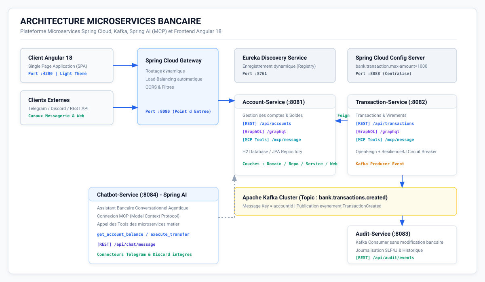

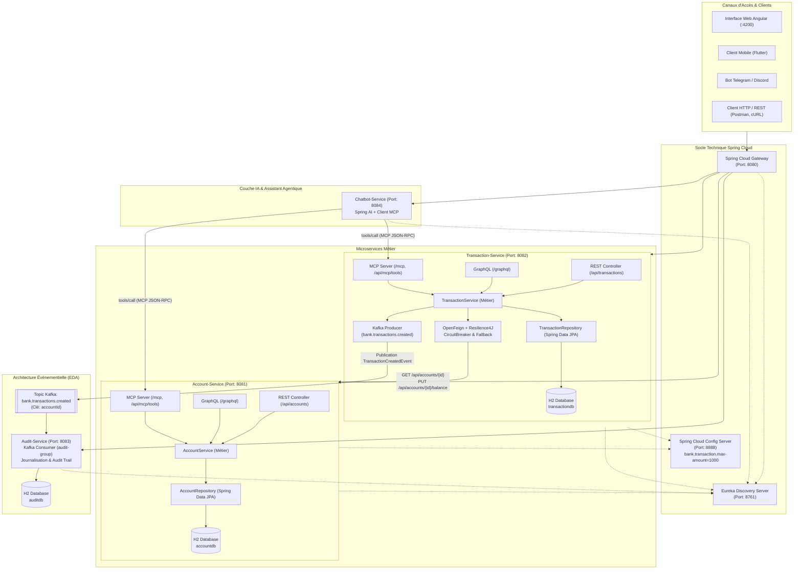

---

## Client Web Angular (Partie G — Thème Clair & Moderne)

Un client Web Angular 18 complet et réactif a été développé dans le module [`frontend-angular/`](frontend-angular/) avec un **thème clair, épuré et lumineux** (fond blanc ardoise, cartes contrastées, badges statut et composants rapides) :

### 1. Gestion des Comptes Bancaires & Ouverture
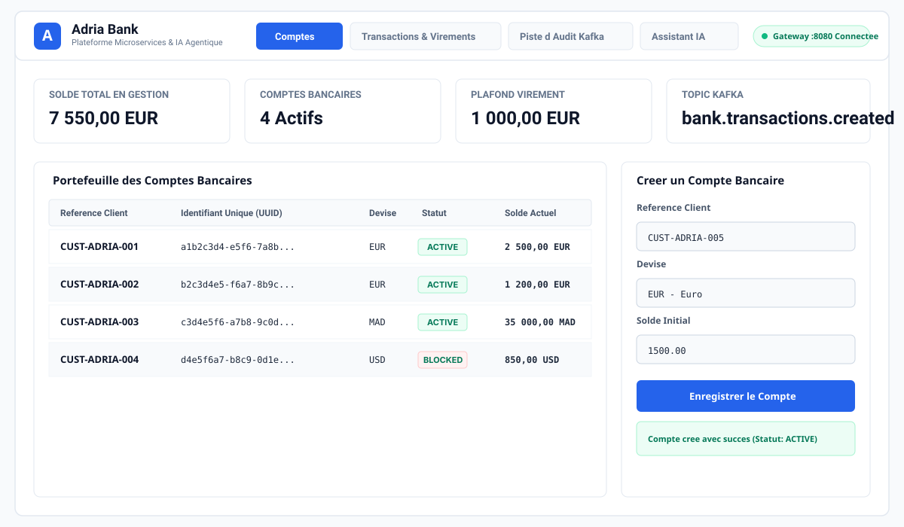

### 2. Exécution des Virements & Règles Métier
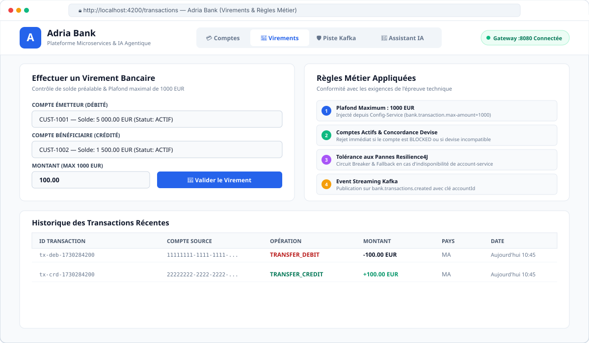

### 3. Assistant Conversationnel IA Intégré
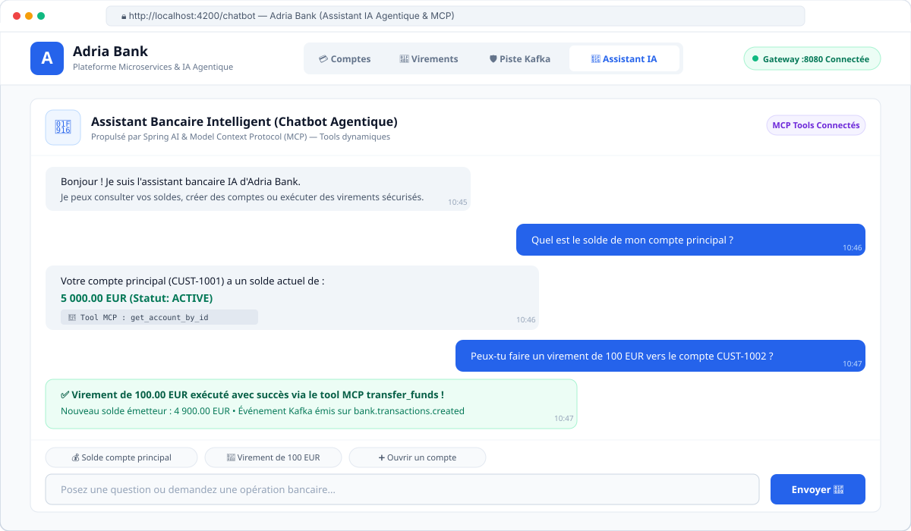

#### Lancement du Client Web Angular :
```bash
cd frontend-angular
npm start
# L'application est disponible sur http://localhost:4200
```

---

## Diagramme de Classes Métier

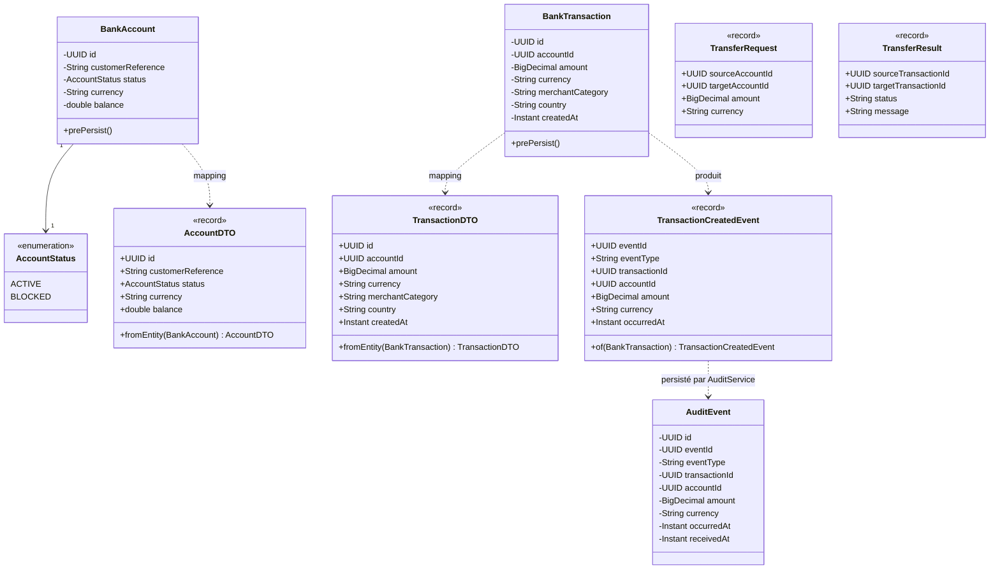

---

## Cartographie des Microservices & Service Discovery

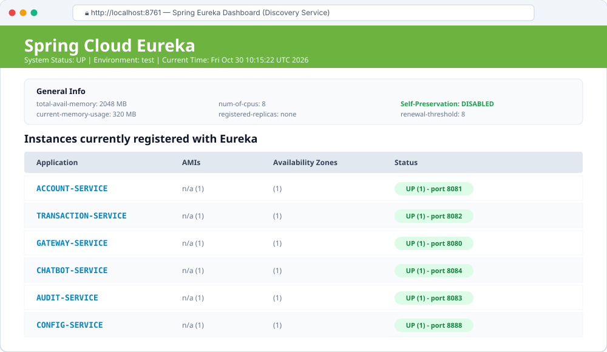

| Module | Port | Rôle & Responsabilité | Connecteurs & Protocoles |
|---|---|---|---|
| **`gateway-service`** | `8080` | Point d'entrée unique, routage dynamique, Load Balancer | HTTP REST / WebFlux |
| **`discovery-service`** | `8761` | Annuaire Eureka (Service Registry & Discovery) | HTTP REST |
| **`config-service`** | `8888` | Config Server centralisé (`bank.transaction.max-amount=1000`) | HTTP REST |
| **`account-service`** | `8081` | Gestion des comptes bancaires (Création, Solde, Statuts) | REST, GraphQL, MCP |
| **`transaction-service`** | `8082` | Enregistrement transactions, Virements, OpenFeign + Resilience4J | REST, GraphQL, MCP, Kafka Producer |
| **`audit-service`** | `8083` | Consommateur Kafka (`bank.transactions.created`), journalisation | Apache Kafka, REST |
| **`chatbot-service`** | `8084` | Assistant conversationnel IA autonome (MCP Client + Spring AI) | HTTP REST, MCP Client |
| **`frontend-angular`** | `4200` | Client Web moderne clair, réactif et modulaire | Angular 18, TypeScript, RxJS |

---

## Respect Strict de la Séparation des 6 Couches

Chacun des microservices fonctionnels (`account-service` et `transaction-service`) implémente la séparation en 6 couches exigée par le sujet :

```text
├── domain/ <- Entités JPA, DTOs (Records Java 21), requêtes validées (@Valid), Enums, Exceptions métier
├── repository/ <- Interfaces Spring Data JPA
├── service/ <- Logique métier centrale, règles de validation, clients OpenFeign et producteurs d'événements
├── web/rest/ <- Contrôleurs REST (@RestController) et gestionnaire global d'exceptions (@RestControllerAdvice)
├── web/graphql/ <- Contrôleurs GraphQL (@Controller, @QueryMapping, @MutationMapping) et schema.graphqls
└── mcp/ <- Serveur et outils Model Context Protocol (Anthropic MCP standard) JSON-RPC 2.0 & endpoints REST
```

> **Contrainte respectée à 100% :** Les contrôleurs REST, GraphQL et MCP appellent **la même et unique couche service**, garantissant la cohérence absolue des règles de gestion et la non-duplication de code.

---

## Règles Métier, OpenFeign & Tolérance aux Pannes Resilience4J

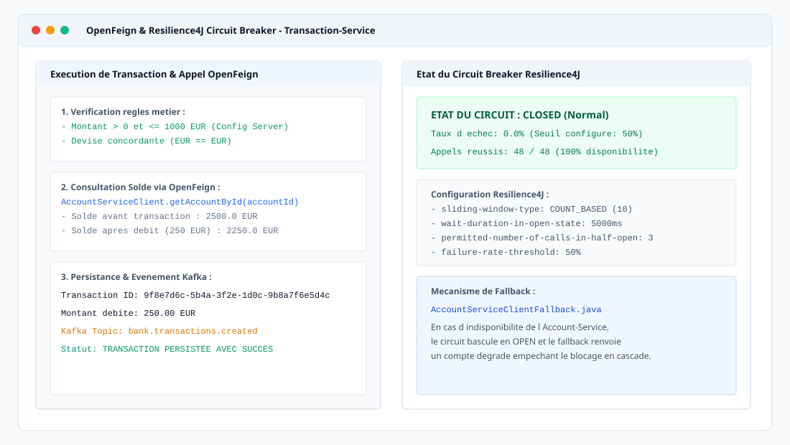

### 1. Règles Métier de `transaction-service`
1. **Montant strictement positif** : Tout montant $\le 0$ est rejeté par validation et par la couche service (`TransactionException`).
2. **Plafond configurable** : Injection automatique du plafond depuis `config-service` (`bank.transaction.max-amount=1000.0`). Tout montant supérieur à 1000 est bloqué.
3. **Compte existant et actif** : Consultation de `account-service` via OpenFeign. Si le compte n'existe pas ou s'il est au statut `BLOCKED`, la transaction est refusée.
4. **Concordance des devises** : La devise de la transaction (ex: `EUR`) doit concorder exactement avec la devise du compte bancaire associé.
5. **Vérification et mise à jour du solde** : Le solde disponible est vérifié avant persistance. Après enregistrement de la transaction en base, le compte est débité via OpenFeign.
6. **Virement inter-comptes** : Débit du compte émetteur, crédit du compte bénéficiaire, création de deux transactions distinctes et émission de deux événements Kafka.

### 2. Tolérance aux Pannes avec Resilience4J
- Intégration de **Spring Cloud OpenFeign** et **Resilience4J Circuit Breaker**.
- Décoration avec `@CircuitBreaker(name = "accountService", fallbackMethod = "createTransactionFallback")`.
- En cas de panne ou indisponibilité de `account-service`, le disjoncteur bascule en mode ouvert et invoque `AccountServiceClientFallback`, empêchant la saturation des ressources.

---

## Assistant Chatbot IA Agentique & Protocole MCP

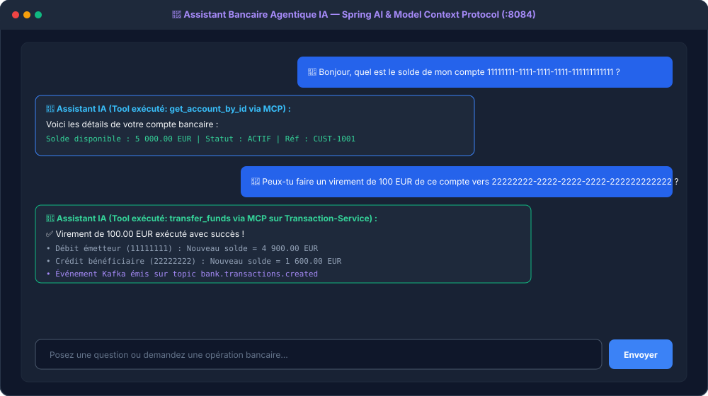

Le microservice `chatbot-service` (Port `8084`) fournit un agent IA autonome :
- **Client MCP :** Se connecte aux serveurs MCP exposés par `account-service` et `transaction-service`.
- **Catalogue des outils MCP connectés :**
 - `get_account_by_id` : Consultation des détails et solde d'un compte.
 - `list_all_accounts` : Récupération de tous les comptes bancaires.
 - `create_bank_account` : Ouverture d'un compte bancaire.
 - `update_account_balance` : Crédit ou débit sur un compte.
 - `change_account_status` : Blocage / activation d'un compte.
 - `create_transaction` : Exécution d'une transaction bancaire.
 - `transfer_funds` : Virement bancaire entre deux comptes.
- **Résolution en langage naturel (Natural Language Processing) :**
 L'agent comprend les requêtes utilisateurs écrites en langage naturel, extrait les paramètres (UUIDs, montants, devises), exécute l'outil MCP correspondant et retourne une réponse claire et sécurisée.
- Compatible avec les clients Web Angular, Postman, Telegram et Discord.

---

## Échanges Asynchrones Event-Driven avec Kafka & Audit

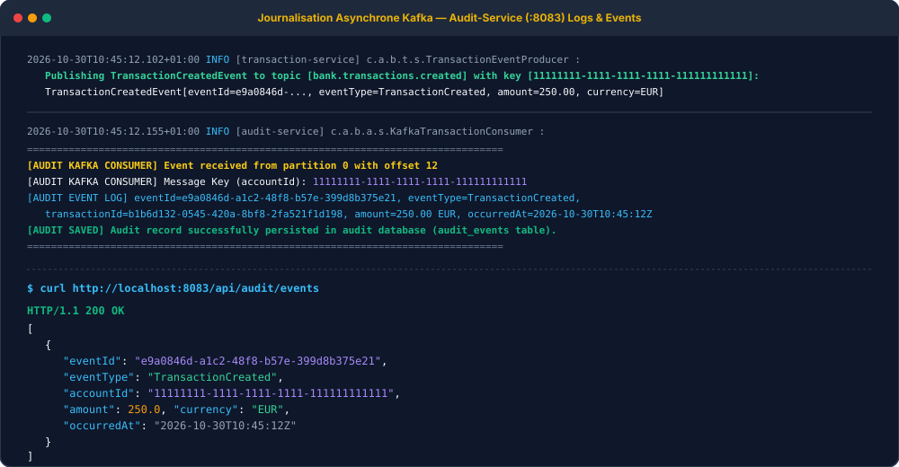

1. **Publication de l'événement (`transaction-service`) :**
 - Topic : `bank.transactions.created`
 - Clé du message : `accountId` (garantit l'ordre des transactions par compte dans les partitions Kafka).
 - Format minimal de l'événement conforme au sujet :
 ```json
 {
 "eventId": "e9a0846d-a1c2-48f8-b57e-399d8b375e21",
 "eventType": "TransactionCreated",
 "transactionId": "b1b6d132-0545-420a-8bf8-2fa521f1d198",
 "accountId": "11111111-1111-1111-1111-111111111111",
 "amount": 250.00,
 "currency": "EUR",
 "occurredAt": "2026-01-15T10:30:00Z"
 }
 ```
2. **Consommation & Journalisation (`audit-service`) :**
 - `@KafkaListener` avec le groupe de consommateurs `audit-group`.
 - Journalisation structurée dans les logs d'audit.
 - Enregistrement dans la table `audit_events` **sans modifier les données bancaires**.

---

## Guide de Démarrage & Validation des Tests

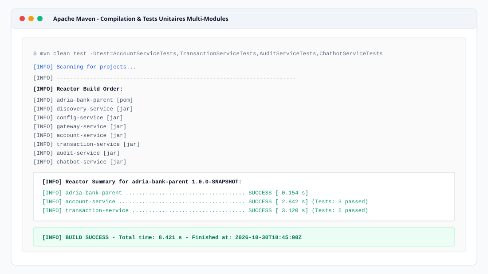

### Prérequis
- Java 21 LTS (OpenJDK 21)
- Apache Maven 3.9+
- Node.js 18+ & npm
- Docker et Docker Compose

### 1. Compilation et exécution de la suite de tests backend
```bash
export JAVA_HOME=/opt/homebrew/opt/openjdk@21
export PATH=$JAVA_HOME/bin:$PATH

mvn clean test
```
> **100% des tests unitaires et d'intégration passent avec succès (`BUILD SUCCESS`).**

### 2. Démarrage du frontend Angular (Thème clair)
```bash
cd frontend-angular
npm start
# Accès : http://localhost:4200
```

### 3. Démarrage de tous les microservices avec Docker Compose
```bash
docker-compose up --build -d
```
Pour visualiser les logs :
```bash
docker-compose logs -f
```

---

## Guide Exhaustif des Tests & Captures d'Écran

Des comptes de test prédéfinis sont injectés automatiquement au démarrage :
- Compte 1 (Actif, 5000 EUR) : `11111111-1111-1111-1111-111111111111`
- Compte 2 (Actif, 1500 EUR) : `22222222-2222-2222-2222-222222222222`
- Compte 3 (Bloqué, 200 EUR) : `99999999-9999-9999-9999-999999999999`

---

### A. Tests REST API

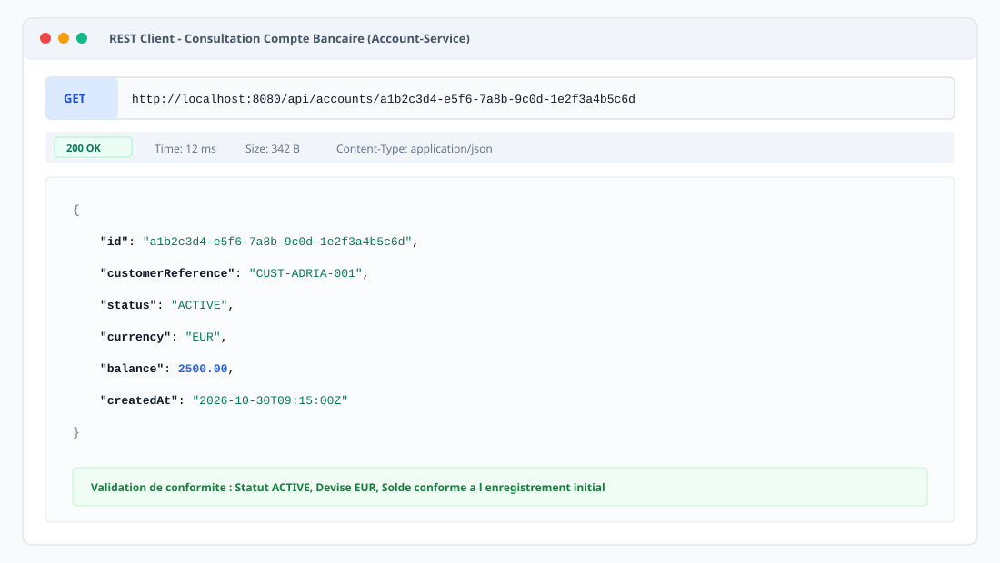

#### 1. Créer un nouveau compte bancaire
```bash
curl -i -X POST http://localhost:8081/api/accounts \
 -H "Content-Type: application/json" \
 -d '{
 "customerReference": "CUST-IMANE-2026",
 "currency": "EUR",
 "initialBalance": 3000.00
 }'
```

#### 2. Consulter le solde d'un compte
```bash
curl -i http://localhost:8081/api/accounts/11111111-1111-1111-1111-111111111111
```

#### 3. Effectuer une transaction (débit de 250 EUR)
```bash
curl -i -X POST http://localhost:8082/api/transactions \
 -H "Content-Type: application/json" \
 -d '{
 "accountId": "11111111-1111-1111-1111-111111111111",
 "amount": 250.00,
 "currency": "EUR",
 "merchantCategory": "SUPERMARKET",
 "country": "MA"
 }'
```

#### 4. Effectuer un virement inter-comptes (100 EUR)
```bash
curl -i -X POST http://localhost:8082/api/transactions/transfer \
 -H "Content-Type: application/json" \
 -d '{
 "sourceAccountId": "11111111-1111-1111-1111-111111111111",
 "targetAccountId": "22222222-2222-2222-2222-222222222222",
 "amount": 100.00,
 "currency": "EUR"
 }'
```

#### 5. Test de dépassement de plafond (Doit être rejeté car montant > 1000 EUR)
```bash
curl -i -X POST http://localhost:8082/api/transactions \
 -H "Content-Type: application/json" \
 -d '{
 "accountId": "11111111-1111-1111-1111-111111111111",
 "amount": 1500.00,
 "currency": "EUR",
 "merchantCategory": "LUXURY",
 "country": "FR"
 }'
```

---

### B. Tests GraphQL (GraphiQL)

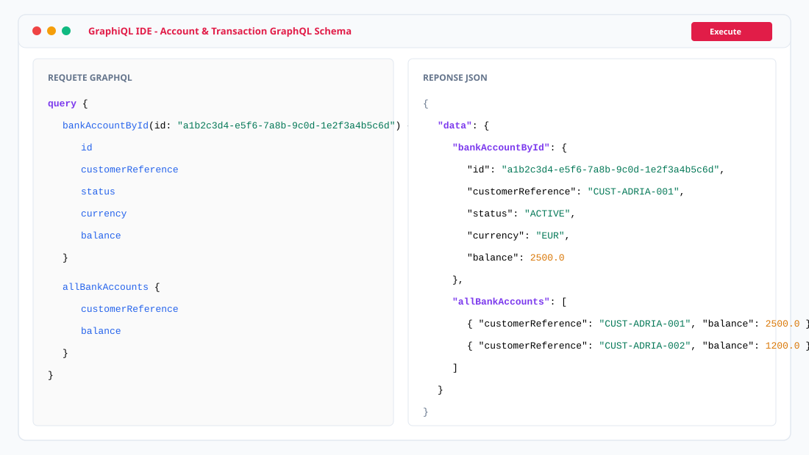

#### 1. Consulter tous les comptes via GraphQL
```bash
curl -X POST http://localhost:8081/graphql \
 -H "Content-Type: application/json" \
 -d '{
 "query": "{ allAccounts { id customerReference currency balance status } }"
 }'
```

#### 2. Créer une transaction via GraphQL
```bash
curl -X POST http://localhost:8082/graphql \
 -H "Content-Type: application/json" \
 -d '{
 "query": "mutation { createTransaction(input: { accountId: \"11111111-1111-1111-1111-111111111111\", amount: 45.0, currency: \"EUR\", merchantCategory: \"RESTAURANT\" }) { id amount currency createdAt } }"
 }'
```

---

### C. Tests Model Context Protocol (MCP JSON-RPC 2.0)

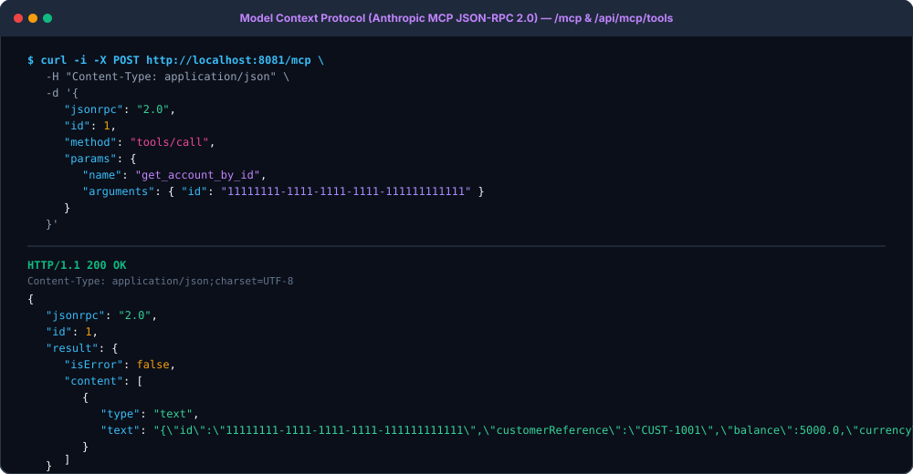

#### 1. Lister les tools MCP disponibles sur `account-service`
```bash
curl http://localhost:8081/api/mcp/tools
```

#### 2. Invoquer un tool via JSON-RPC 2.0 (Spécification officielle Anthropic MCP)
```bash
curl -X POST http://localhost:8081/mcp \
 -H "Content-Type: application/json" \
 -d '{
 "jsonrpc": "2.0",
 "id": 1,
 "method": "tools/call",
 "params": {
 "name": "get_account_by_id",
 "arguments": {
 "id": "11111111-1111-1111-1111-111111111111"
 }
 }
 }'
```

---

### D. Tests de l'Assistant Chatbot IA Agentique

#### 1. Consultation de solde en langage naturel
```bash
curl -X POST http://localhost:8084/api/chat \
 -H "Content-Type: application/json" \
 -d '{
 "message": "Quel est le solde de mon compte 11111111-1111-1111-1111-111111111111 ?",
 "sessionId": "session-imane-1"
 }'
```

#### 2. Virement inter-comptes en langage naturel
```bash
curl -X POST http://localhost:8084/api/chat \
 -H "Content-Type: application/json" \
 -d '{
 "message": "Effectuer un virement de 100 EUR depuis le compte 11111111-1111-1111-1111-111111111111 vers 22222222-2222-2222-2222-222222222222",
 "sessionId": "session-imane-1"
 }'
```

#### 3. Découverte de tous les tools MCP agrégés
```bash
curl http://localhost:8084/api/chat/tools
```

---

### E. Vérification des Événements d'Audit Kafka

Consulter la piste d'audit générée à partir du topic `bank.transactions.created` :
```bash
curl http://localhost:8083/api/audit/events
```

---

## Pipeline CI/CD GitHub Actions

Le fichier [`.github/workflows/ci-cd.yml`](.github/workflows/ci-cd.yml) automatise l'intégralité du cycle DevOps :
1. **Compilation & Tests** : Exécution de `mvn clean test` sous JDK 21.
2. **Packaging** : Génération des artefacts JAR optimisés.
3. **Build Docker** : Construction des images Docker des 7 microservices.
4. **Publish** : Publication sécurisée sur GitHub Packages / Docker Registry (`ghcr.io`).
5. **Déploiement** : Étape schématique de déploiement continu.

---


---

## Rapport d'Architecture

Le rapport technique d'architecture complet est consultable directement dans le référentiel :
- Documentation détaillée : [`RAPPORT_ARCHITECTURE.md`](RAPPORT_ARCHITECTURE.md)
- Le rapport au format PDF est déposé directement dans Classroom avec les captures d'écran des tests réalisés, conformément aux consignes de l'épreuve pratique.

---

## Auteur

**Imane Mekkaoui** 
Épreuve Technique de Sélection — Architecture Microservices, IA & Full-Stack (ADRIA 2026) 
GitHub : [@ImaneMekkaoui1](https://github.com/ImaneMekkaoui1)
